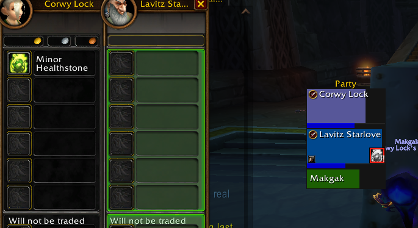

# StoneWatch 1.0.5 - WoW Forever beta

Warlocks can see when a party or raid member uses a health stone/cookie/lock rock, to trade them a new one. The icons update and alert is shown when combat ends, since the API is restricted.

Need either the Blizzard Damage Meters enabled, or Details addon.

Options to anchor the icons around the unit frames in any way.

Optional HUD for the Warlock to see # Given and # Used, and times when used.

Requested, tested, and appreciated by my Warlock friends. Warriors will be healthier than ever.

## Install

Extract the StoneWatch folder into your Forever client's Interface/AddOns
folder, then restart WoW. Warlocks who want to share their refills need this
updated version of StoneWatch. Healthstone recipients do not need it.

## Using it

Trade a healthstone to a party or raid member before a fight. A green stone
icon means you or another StoneWatch user supplied them. After a matching
use is recorded and the group leaves combat, the icon is desaturated with
a bright red outline and a white exclamation mark. A completed replacement
trade restores the green icon and clears the outline and exclamation mark.
Unknown players have no icon.

Icons support Blizzard's party and raid frames. Your own
character has no frame icon. The movable HUD shows Given and Used counts
for current group members you or other StoneWatch users supplied. Given
means no use detected since the latest refill; Used means a use was
recorded. Hover for names, left-click to keep the list open with recent
uses, or right-click for options. With more than ten tracked players the
list names those who used a stone and counts the rest.
Sound and local chat notices start disabled.

## Automatic sync with other warlocks

StoneWatch users in the same party or raid automatically share confirmed
healthstone trades and usage recorded after combat. There is no sync setting
to configure and no visible party or raid chat spam. Records are exchanged
when group members join or reload, after combat, and periodically to recover
missed updates. Catch-up records update icons without playing old notices.

Shared refills restore green icons and establish a local damage meter
baseline. Duplicate or older refill records do not reset newer trades, and
an old supplied snapshot cannot turn a used stone green again. Updates wait
while combat or chat restrictions are active. /sw status shows sync status.
Trades by players without this updated StoneWatch remain unknown.

## Options

Open Options -> AddOns -> StoneWatch, or use /sw options. Choose icon size
from 10 to 24 pixels, show or hide frame icons, the HUD, and the minimap
button, lock or unlock the HUD, and enable sound or local chat notices.
The page also has buttons for tracked players, scanning healing data,
resetting the HUD position, clearing trades and history, restoring default
settings, and showing tracking status. Settings are saved per character.

Frame icons start outside the right edge of each frame, vertically centered.
Party frames and raid frames each have their own position: outside any side
of the frame, or inside on the health bar at a corner, an edge, or the
center. Two sliders nudge the icon up to 30 pixels left or right and down
or up.

Left-click the minimap button for tracked players, right-click for options,
or drag it around the minimap. Its position and visibility are saved.

## Commands

| Command | What it does |
| --- | --- |
| /sw | Open tracked players and recent uses |
| /sw options | Open StoneWatch in Blizzard's Options menu |
| /sw unlock | Allow dragging the HUD; /sw lock locks it again |
| /sw reset | Restore the HUD's position |
| /sw size 18 | Set icon size from 10 to 24 |
| /sw scan | Check readable healing data again |
| /sw status | Show troubleshooting information |
| /sw clear | Clear local tracked trades and recent uses |

## Limits

Detection depends on recorded healthstone healing from the damage meter.
Uses with no recorded healing may be missed. Group icons show the last
observed state; the addon cannot inspect another player's inventory.
Counts refer to players, not item quantities, charges, or cooldowns.
Clearing local records does not clear another user's records. Their shared
state can appear again when automatic synchronization runs.

Trades before a fight are tracked in future combat sessions. Existing
sessions are excluded so an earlier use cannot mark a replacement used.
Trades during an ongoing or combined session may miss that session's use.
Trades survive /reload; a fresh login clears group stock assumptions.

## Data Source

StoneWatch automatically uses a compatible loaded version of Details;
otherwise it uses Blizzard's damage meter. There is no source setting.
With Details, the Blizzard meter window can stay hidden. Without Details,
enable Blizzard's damage meter so it records healing. Both use Blizzard
combat data in Forever and update after combat. /sw status shows the
detected source.

## Credits

Lavitz Starlove designer & developer.
Corwynn for inspiration & collaboration.
